# ⚡ Awesome LLM Inference Engine &amp; Model Serving 🚀

  <strong>Curated directory of high-throughput LLM inference engines, GPU/CPU serving runtimes, speculative decoding frameworks, and enterprise model orchestration platforms.</strong>

  
  
  
  
  

---

## 📑 Table of Contents 📌

- [📊 Sector Overview & Market Dynamics](#-sector-overview--market-dynamics)
- [☁️ SaaS / Hosted Platforms](#️-saashosted-platforms)
- [🛠️ Open-Source Equivalents & Tools](#️-open-source-equivalents--tools)
  - [🚀 High-Throughput GPU LLM Inference Engines](#-high-throughput-gpu-llm-inference-engines)
  - [💻 Local, Edge, CPU & Apple Silicon Inference Runtimes](#-local-edge-cpu--apple-silicon-inference-runtimes)
  - [🏢 Enterprise Multi-Model & Distributed Serving Servers](#-enterprise-multi-model--distributed-serving-servers)
  - [⚡ Speculative Decoding, Quantization & Kernel Accelerators](#-speculative-decoding-quantization--kernel-accelerators)
  - [🌐 Browser, WebGPU & Mobile LLM Inference Engines](#-browser-webgpu--mobile-llm-inference-engines)
- [📈 Star History](#-star-history)
- [🤝 Contributing](#-contributing)
- [💖 Support & Sponsorship](#-support--sponsorship)

---

## 📊 Sector Overview & Market Dynamics

The global AI inference market is projected to expand from **$100+ Billion** in 2024 to over **$350–$400 Billion by 2030** (growing at ~18% CAGR) as production workloads pivot en masse from model pre-training to continuous real-time execution and agentic reasoning loops.

Market concentration exhibits a distinct dual structure: **hardware and core hyperscale infrastructure are heavily concentrated** (an oligopoly dominated by NVIDIA's GPU ecosystem and custom hyperscaler ASICs), whereas **the inference runtime, serving middleware, and quantization software layer is moderately fragmented**, characterized by rapid open-source innovation, specialized neoclouds, and performance competition between PagedAttention/RadixAttention engines.

---

## ☁️ SaaS / Hosted Platforms

Commercial, cloud-hosted ultra-fast AI inference clouds, specialized LPU/WSE hardware endpoints, and managed serverless model serving APIs, sorted descending by company scale (market capitalization / valuation / enterprise scale).

| Platform | Description | Scale (Revenue / Valuation) | Pricing (Starting Tier) | Free Tier Limits |
| :--- | :--- | :--- | :--- | :--- |
| **[NVIDIA NIM (build.nvidia.com)](https://nvidia.com)** | Managed cloud microservices packaging TensorRT-LLM and Triton Inference Server into enterprise-ready containers. | **Market Cap: ~$3.5T+** (FY25 Revenue: $115B+) | Self-hosted production licenses via NVIDIA AI Enterprise at $4,500 / GPU / year; cloud partner consumption pricing varies | Free developer account includes 1,000 free inference credits and up to 40 requests/minute (RPM) for prototyping |
| **[Red Hat AI Inference Server](https://redhat.com)** | Enterprise-supported cloud and hybrid deployments of vLLM with production SLAs, security hardening, and distributed scaling. | **Acquired by IBM for $34B** (Annual Revenue: $6.5B+) | Starting at $0.05 / GPU / hour on public cloud marketplaces; 1-year node subscription via enterprise sales | 60-day free trial evaluation available for Red Hat enterprise software platforms upon account registration |
| **[Cerebras Inference Cloud](https://cerebras.ai)** | Wafer-Scale Engine (WSE-3) cloud inference platform offering industry-leading token generation speeds for frontier open-weights LLMs. | **Valuation: ~$26B–$33B** (2025 Revenue: $510M) | Developer Tier starting at $0.35 / 1M input tokens and $0.75 / 1M output tokens (GPT-OSS 120B); subscription bundles from $50/month | Free trial with $5 one-time promotional credit valid for 30 days upon adding a payment method (no permanent free tier) |
| **[Hugging Face Inference Endpoints](https://huggingface.co)** | Dedicated, fully managed cloud deployment platform powered by Text Generation Inference (TGI) across AWS, GCP, and Azure. | **Valuation: $4.5B–$13B** (ARR: $150M+) | Dedicated GPU instances starting at ~$0.50 / hour (e.g., NVIDIA T4 / A10G); billed per hour running | No free tier for dedicated Inference Endpoints; free tier is limited to serverless Inference API with shared community rate limits |
| **[Together Inference Engine](https://together.ai)** | Managed cloud inference platform powered by FlashAttention and speculative decoding optimizations for open-source foundation models. | **Valuation: ~$3.3B–$8.3B** (ARR: $110M+) | Pay-as-you-go starting at $0.15 / 1M input tokens and $0.50 / 1M output tokens (initial minimum credit deposit of $15) | No free tier or recurring free trial; strictly prepaid model with baseline starting rate limit of 1 RPS (60 RPM) |
| **[Fireworks AI](https://fireworks.ai)** | High-speed, low-latency generative AI inference cloud engineered with custom CUDA kernels and multi-LoRA serving. | **Valuation: ~$4.0B** (ARR: $305M) | Pay-as-you-go starting at $0.10 / 1M input tokens and $0.30 / 1M output tokens (small/flash models) | Free trial with $1 one-time signup credit capped at 10 requests/minute (no permanent recurring free tier) |
| **[GroqCloud](https://groq.com)** | Ultra-low-latency AI inference cloud powered by custom LPU (Language Processing Unit) hardware delivering hundreds of tokens per second. | **Valuation: ~$3.5B–$6.9B** (ARR: $90M–$170M) | Pay-as-you-go starting at $0.075 / 1M input tokens and $0.30 / 1M output tokens (GPT-OSS 20B) | Free tier available forever: up to 8,000–30,000 TPM (model-dependent), 200,000 tokens/day, 30 RPM, and 1,000 requests/day |
| **[SambaNova Cloud](https://sambanova.ai)** | Enterprise AI inference cloud running on Reconfigurable Dataflow Units (RDUs) for high-speed, massive-context LLM serving. | **Valuation: ~$5.1B** ($1.1B+ venture funded) | Developer Tier starting at $0.22 / 1M input tokens and $0.59 / 1M output tokens (gpt-oss-120b) | Free tier available forever: 20 requests/minute (RPM), 20 requests/day (RPD), and 200,000 tokens/day per model |
| **[Baseten](https://baseten.co)** | Commercial high-performance model serving infrastructure offering autoscaling GPU clusters, cold-start optimization, and TensorRT-LLM pipelines. | **Valuation: ~$2.2B** (ARR: ~$200M) | Pay-as-you-go GPU instance billing starting at ~$0.30 / hour (T4) or token APIs; $0 base platform fee | Free trial offering $30 one-time compute credits upon account setup (no permanent recurring free tier) |
| **[Modal](https://modal.com)** | Serverless GPU cloud platform providing container-native execution, rapid cold-starts, and serverless inference runtimes. | **Valuation: ~$1.1B** (ARR: ~$60M–$100M) | Pay-per-second compute starting at ~$0.000164 / second (~$0.59 / hour for T4 GPU) | Free Starter tier forever includes $30 / month recurring compute credit (~50 hours of T4 GPU time, max 10 concurrent GPUs) |
| **[Replicate](https://replicate.com)** | Serverless AI platform running open-source models via hosted cloud API with autoscaling. | **Acquired by Cloudflare** (Pre-acquisition Val: $350M) | Pay-per-second starting at ~$0.000140 / second (~$0.50 / hour for Nvidia T4) or per-token endpoints | Free trial collection allows running select public demo models for a limited initial batch of runs (no recurring free tier) |
| **[DeepInfra](https://deepinfra.com)** | Pay-per-token and serverless GPU hosting platform providing instant API endpoints for open-weights LLMs. | **Valuation: ~$100M+** (Profitable bootstrapped/seed) | Pay-as-you-go starting at $0.09 / 1M input tokens and $0.15 / 1M output tokens (e.g., Llama-3.1-8B) | No permanent free tier; accounts require credit card or prepayment; offers DeepStart startup credits program for eligible startups |

---

## 🛠️ Open-Source Equivalents & Tools

Free and open-source software (FOSS) LLM inference engines, PagedAttention/RadixAttention runtimes, C/C++ local model runners, quantization kernels, and Kubernetes serving orchestrators. Each subsection is sorted descending by GitHub star count.

### 🚀 High-Throughput GPU LLM Inference Engines

* **[vLLM](https://github.com/vllm-project/vllm)**  - High-throughput and memory-efficient LLM inference and serving engine with PagedAttention.
* **[DeepSpeed](https://github.com/microsoft/DeepSpeed)**  - DeepSpeed-FastGen dynamic SplitFuse scheduling for high-throughput inference.
* **[SGLang](https://github.com/sgl-project/sglang)**  - Blazingly fast serving framework for LLMs and VLMs with RadixAttention prefix caching.
* **[TensorRT-LLM](https://github.com/NVIDIA/TensorRT-LLM)**  - NVIDIA library compiling LLMs into optimized TensorRT engines with FP8/INT4 quantization.
* **[TGI](https://github.com/huggingface/text-generation-inference)**  - Production-grade Rust & Python toolkit for serving LLMs with continuous batching.
* **[LMDeploy](https://github.com/InternLM/lmdeploy)**  - High-throughput toolkit for deploying and serving LLMs and VLMs powered by TurboMind engine.
* **[mistral.rs](https://github.com/EricLBuehler/mistral.rs)**  - Blazingly fast LLM inference platform in pure Rust with support for device-agnostic quantized execution.
* **[Aphrodite Engine](https://github.com/PygmalionAI/aphrodite-engine)**  - High-throughput LLM inference engine supporting EXL2, AWQ, GPTQ, GGUF, FP8.

### 💻 Local, Edge, CPU & Apple Silicon Inference Runtimes

* **[Ollama](https://github.com/ollama/ollama)**  - Effortless local model runner and OpenAI-compatible REST server built on llama.cpp.
* **[llama.cpp](https://github.com/ggerganov/llama.cpp)**  - Foundational C/C++ LLM inference engine for fast quantized execution on CPU, GPU, Apple Metal.
* **[LocalAI](https://github.com/mudler/LocalAI)**  - Self-hosted, drop-in OpenAI-compatible API serving local LLMs without GPU requirements.
* **[Jan](https://github.com/janhq/jan)**  - Open-source, local-first alternative to ChatGPT running local LLMs offline on consumer machines.
* **[MLX](https://github.com/ml-explore/mlx)**  - Apple array framework and MLX-LM engineered specifically for unified memory on Apple Silicon.
* **[KoboldCpp](https://github.com/LostRuins/koboldcpp)**  - Single-file, zero-dependency LLM inference binary with integrated web UI and API.
* **[PowerInfer](https://github.com/SJTU-IPADS/PowerInfer)**  - Fast LLM inference exploiting neuron activation locality for CPU/GPU hybrid execution.
* **[ExLlamaV2](https://github.com/turboderp-org/exllamav2)**  - Ultra-fast inference library for running quantized EXL2/GPTQ LLMs with minimal VRAM overhead.
* **[ik_llama.cpp](https://github.com/ikawrakow/ik_llama.cpp)**  - Performance fork of llama.cpp introducing advanced quantization formats (IQK) and faster CPU kernels.

### 🏢 Enterprise Multi-Model & Distributed Serving Servers

* **[Ray](https://github.com/ray-project/ray)**  - Distributed compute framework and Ray Serve for scalable multi-node LLM pipelines and composition.
* **[Tabby](https://github.com/TabbyML/tabby)**  - Self-hosted AI coding assistant server with built-in model serving for code completion.
* **[OpenLLM](https://github.com/bentoml/OpenLLM)**  - Production platform for running and operating any open-weights LLM in production and Kubernetes.
* **[Triton Inference Server](https://github.com/triton-inference-server/server)**  - NVIDIA multi-framework inference serving software across TensorRT-LLM, vLLM, ONNX Runtime.
* **[BentoML](https://github.com/bentoml/BentoML)**  - Unified framework for building, containerizing, and serving production AI and LLM applications.
* **[KServe](https://github.com/kserve/kserve)**  - Standard Kubernetes-native model inference platform supporting serverless autoscaling and canary rollouts.
* **[llm-d](https://github.com/llm-d/llm-d)**  - Disaggregated inference serving framework for disaggregated prefill/decode multi-node GPU clusters.
* **[LitServe](https://github.com/Lightning-AI/litserve)**  - High-speed AI model serving engine built on FastAPI supporting dynamic batching and streaming.

### ⚡ Speculative Decoding, Quantization & Kernel Accelerators

* **[FlashAttention](https://github.com/Dao-AILab/flash-attention)**  - Fast, memory-efficient exact attention CUDA kernels foundational to modern LLM inference.
* **[bitsandbytes](https://github.com/bitsandbytes-foundation/bitsandbytes)**  - Accessible 8-bit and 4-bit CUDA quantization library for deep learning and LLM serving.
* **[FlashInfer](https://github.com/flashinfer-ai/flashinfer)**  - High-performance kernel library providing customizable attention, KV-cache, and sampling.
* **[AutoGPTQ](https://github.com/AutoGPTQ/AutoGPTQ)**  - User-friendly LLM quantization package with 4-bit quantization and Marlin/Triton kernels.
* **[Medusa](https://github.com/FasterDecoding/Medusa)**  - Simple speculative decoding framework accelerating LLM generation by 2x–3x without extra models.
* **[EAGLE](https://github.com/SafeAILab/EAGLE)**  - Lossless speculative sampling framework delivering 2x–3x speedup on LLM inference.
* **[AutoAWQ](https://github.com/casper-hansen/AutoAWQ)**  - Activation-Aware Weight Quantization (AWQ) toolkit delivering 3x faster 4-bit inference.
* **[GPTQModel](https://github.com/ModelCloud/GPTQModel)**  - Production-grade open-source LLM quantization toolkit supporting GPTQ and Marlin kernels.

### 🌐 Browser, WebGPU & Mobile LLM Inference Engines

* **[MLC LLM](https://github.com/mlc-ai/mlc-llm)**  - Universal LLM deployment engine compiling models natively for WebGPU, iOS, Android, Vulkan.
* **[WebLLM](https://github.com/mlc-ai/web-llm)**  - High-performance in-browser LLM inference engine leveraging WebGPU acceleration.
* **[Transformers.js](https://github.com/huggingface/transformers.js)**  - Run state-of-the-art ML and quantized LLMs directly inside web browsers with WebGPU.
* **[ExecuTorch](https://github.com/pytorch/executorch)**  - PyTorch-native on-device inference runtime for iOS, Android, and embedded devices.
* **[ONNX Runtime GenAI](https://github.com/microsoft/onnxruntime-genai)**  - Microsoft generative AI extensions for running LLMs across Windows DirectML, mobile, CPU.

---

## 📈 Star History

---

## 🤝 Contributing 🌟

Contributions, suggestions, and corrections are always welcome! 

1. 🍴 Fork the repository.
2. 🌿 Create your feature branch (`git checkout -b feature/awesome-inference-engine`).
3. 💾 Commit your changes (`git commit -m 'Add awesome inference framework'`).
4. 🚀 Push to the branch (`git push origin feature/awesome-inference-engine`).
5. 📬 Open a Pull Request.

---

## 💖 Support & Sponsorship 🙏

Thank you for exploring this curated repository! If you find this directory helpful for your AI architecture, benchmarking, or inference deployment:

* ⭐ **Star** this repository to help others discover it!
* 🍴 **Fork** and contribute new tools, performance benchmarks, and engine integrations.
* 📢 **Share** with colleagues and AI engineering communities on Twitter, LinkedIn, and Reddit.
* ☕ **Buy me a coffee / Sponsor**: If you'd like to support ongoing curation and maintenance, consider sponsoring via the [GitHub Sponsor Dashboard](https://github.com/sponsors/ishandutta2007).
